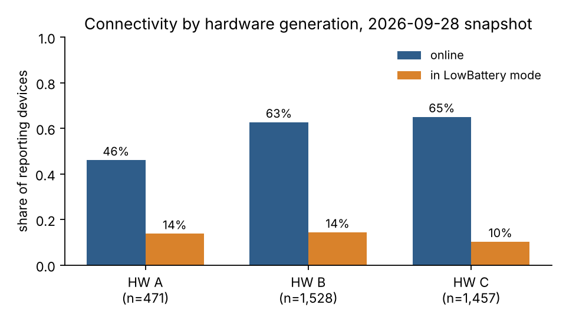
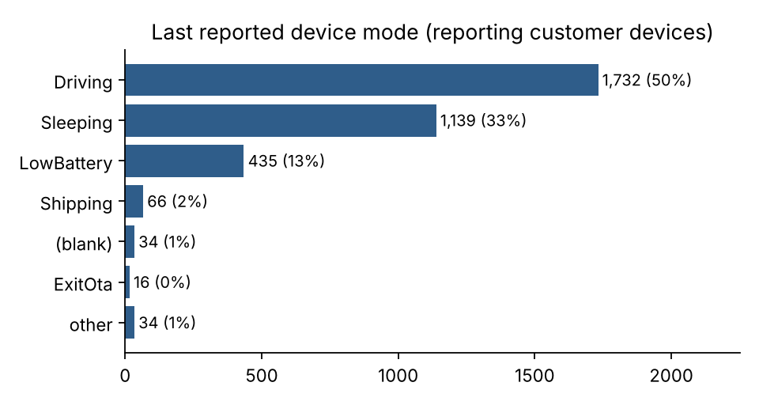
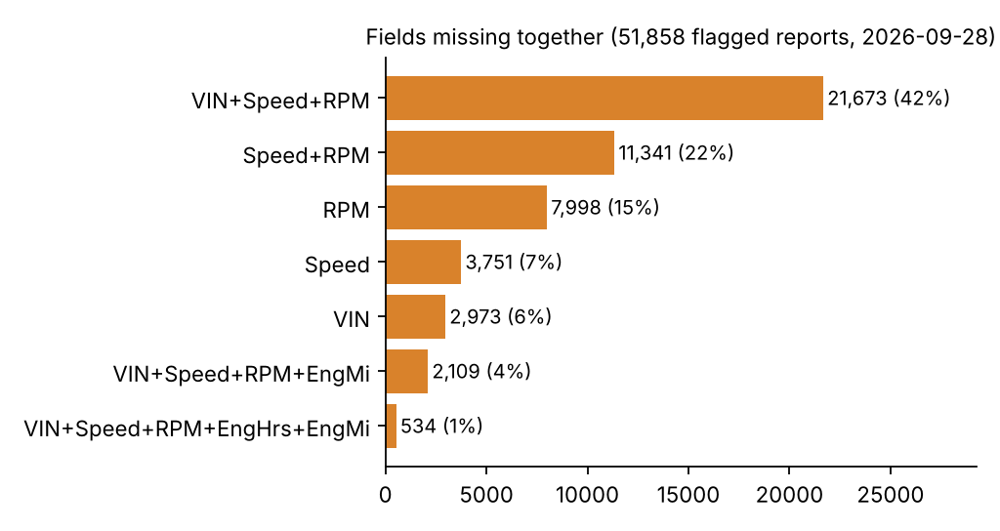
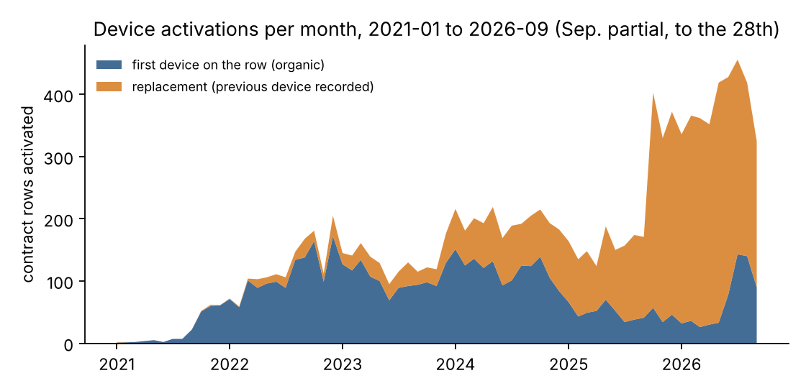
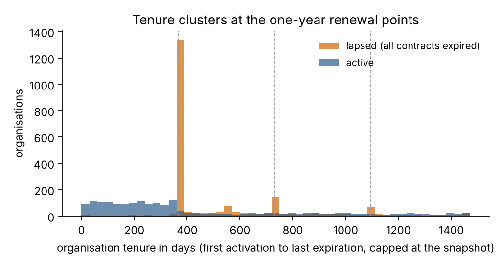

# Fleet snapshot findings — 2026-09-28

Computed from the public tables by `scripts/fleet_snapshot_findings.py`. "Customer devices" excludes the internal test group. Figures are in `reports/figures/`.

## 1. Connectivity and device health

- **4,901 ELD units** are registered in the device-management system; **1,445 (29.5%)** have never reported telemetry (inventory / shipping). Of the **3,456 reporting customer devices**, **61.4% were online** at the snapshot.
- Online rate rises with hardware generation: **HW A 46% → HW B 63% → HW C 65%** (figure 1). Firmware is confounded with hardware (newer firmware ships on newer boards), so this is a descriptive comparison, not an effect estimate.
- **12.6% of reporting devices (435) last reported in `LowBattery` mode** and **85** report a backup battery at 20 % or below — a concrete service queue for installers (external power / wiring checks).
- **500 reporting devices (14.5%) have not updated in more than 30 days**; **40.0%** still show a placeholder VIN (the ECM has never been read successfully) and **6.0%** report no valid GPS fix.
- SIM quotas are healthy: only **32** of 4,901 customer SIMs are Low-Data or Depleted (median remaining data 433 MB of a 500 MB plan).

## 2. ECM-disconnect anomalies (field-anomaly rules, one day)

- The anomaly rules flagged **51,858 reports from 1,845 devices** on 2026-09-28 (1,803 customer devices, i.e. **52.2% of reporting customer devices**).
- The dominant pattern is **VIN + Speed + RPM missing together — 46.9% of flagged reports — with a median GPS speed of 96 km/h**: the vehicle is moving but the ELD is not receiving engine data. For a regulated ELD this is a compliance exposure, not a cosmetic gap (figure 3).
- **1,176 devices had RPM missing on 100 % of their flagged reports** that day; across the 23–25 Sep window, **29 of 215 devices were present all three days with ≥ 90 % RPM missing (chronic)** versus **49 with < 20 % (transient)**. Chronic devices are the field-service list; transient ones are mostly power-cycle or protocol hand-off noise.
- The small **"Volvo 2026" group stands out: 98% of its flagged reports are moving-while-silent across its 15 devices, versus 33%–61% for the regular RT63–RT67 batches** — consistent with an ECM protocol / wiring issue on the newest model-year trucks rather than random hardware failure.
- These devices rarely surface through support: in the field-issue tracker covering Apr–Sep 2026, only 1 of the 29 chronic devices appears (and not for an OBD complaint). Proactive monitoring sees what the ticket queue does not.

## 3. Customer base and contract lifecycle (CRM, 2019–2026)

- **5,667 organisations** appear across the CRM, the app master and the contract history. Lifecycle at the snapshot: **2,025 active**, **2,224 lapsed** (every contract expired, none active), 359 inactive but not yet expired, 700 without usable dates.
- The business is **owner-operator heavy**: median fleet ever contracted is **2 vehicle(s)**, 90 % of organisations have **≤ 5** and 99 % **≤ 14**.
- Contracts are one-year terms: **74.1% of activation→expiration spans are exactly 365 days**, and organisation tenure clusters at the renewal points — 10/25/50/75/90th percentiles of **123/300/365/730/1180 days** (figure 5). The first renewal is the decisive churn moment.
- Among the 3,808 units with a return date, the median lifetime was **266 days** after activation and **89.9% were returned before the first anniversary** — churn is overwhelmingly a first-year event.
- Activations grew every year — 2021: 222, 2022: 1,474, 2023: 1,587, 2024: 2,356, 2025: 2,516, 2026: 3,468 (2026 through September) — and in 2026 **82.4% of activations carried a previous device**, i.e. the hardware-generation migration is a large share of volume (figure 4).
- Vehicles are heavy-duty tractors: **66.8% Freightliner, 25.1% Volvo**, median model year 2020, **81.6% registered in California**.

## 4. What this snapshot cannot tell you

- One day of anomaly rules and one DMS snapshot: no trend. The 3-day window (23–25 Sep) and the 3–4 Aug window are the only longitudinal views until daily exports accumulate.
- `connect_status` is a point-in-time flag; "offline" includes parked vehicles, so online rate is a utilisation-and-health mix, not a defect rate.
- The DTC / pedal / transmission columns are blank in this export, so nothing here speaks to engine fault codes.
- Contract rows are device/vehicle level; organisation churn is derived (see `dim_org.org_lifecycle_status`) and should be read with the data-quality report (26 active rows are already past expiration; 25 returns precede activation).
